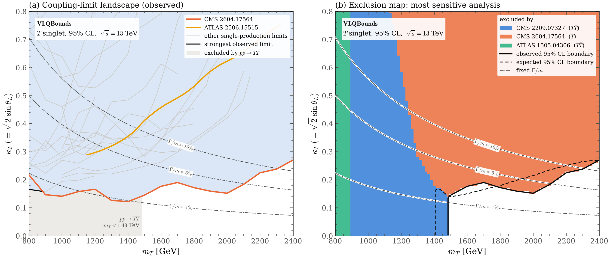
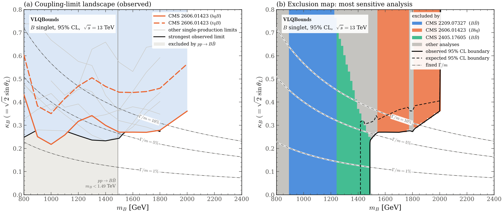

<div align="center">

# VLQBounds

**Confront vector-like quark models with ATLAS and CMS exclusion limits.**

[](https://arxiv.org/abs/2605.20848)
[020-1f4e79.svg)](https://doi.org/10.1007/JHEP03(2025)020)
[](https://github.com/BSMTools/VLQBounds/actions/workflows/ci.yml)
[](https://www.python.org)
[](LICENSE)



</div>

VLQBounds is a data-driven Python tool that tells you whether a vector-like quark
(VLQ) parameter point is excluded at 95% CL by the LHC. For every point it
evaluates all relevant ATLAS and CMS searches, in both **pair** and **single**
production, identifies the **most sensitive analysis**, and returns the observed
and expected sensitivity ratios together with the metadata needed to reproduce
the result.

- **260 limit curves from 64 ATLAS and CMS analyses** at 8 and 13 TeV, stored as
  machine-readable JSON.
- **All common representations**: singlets, $(T,B)$, $(X,T)$, $(B,Y)$ doublets,
  the $(T,B,Y)$ triplet, and pure decay modes.
- **Three parameterisations** of the same model: mixing angle, coupling
  $\kappa$, or width-to-mass ratio $\Gamma/m$.
- **Cross-section and coupling limits** handled in one framework, with explicit
  conversion of each experiment's coupling convention.
- **Validated against the papers**: regression tests reproduce mass and
  coupling limits quoted by ATLAS and CMS ([Validation](#validation)).

## Installation

```bash
git clone https://github.com/BSMTools/VLQBounds.git
cd VLQBounds
python -m pip install -e ".[plot]"
```

Python ≥ 3.10. Core dependencies: `numpy`, `scipy`, `pandas`; `matplotlib` for
plotting. See [INSTALLATION.md](INSTALLATION.md) for a step-by-step guide.

## Quick start

```python
from vlqbounds.models import TopPartnerSinglet
from vlqbounds.inference import VLQBounds

bounds = VLQBounds(TopPartnerSinglet())
bounds.prepare_analysis()

# Three equivalent ways to specify the same model point
bounds.singletT_params(mT=1800.0, s_l=0.15)   # mixing angle sin(theta_L)
bounds.check_against_xs_and_coupling_limits()

bounds.singletT_params(mT=1800.0, k_T=0.30)   # coupling kappa_T
bounds.check_against_xs_and_coupling_limits()

bounds.singletT_params(mT=1800.0, w_m=0.05)   # width-to-mass ratio
bounds.check_against_xs_and_coupling_limits()

print(bounds.df[["mass", "mixing", "coupling", "obs_ratio", "exp_ratio", "result", "label"]])
bounds.print_result()                         # formatted report
```

Each row reports the mass, mixing, coupling and width, the observed and expected
ratios (prediction / limit, so $\ge 1$ means excluded), the verdict
(`result = 0` excluded, `1` allowed) and the most sensitive analysis with its
process, experiment, energy and luminosity.

### Supported models

| Representation | Model class | Point setter | Parameters |
|---|---|---|---|
| $T$ singlet | `TopPartnerSinglet` | `singletT_params` | `mT` + one of `s_l`, `k_T`, `w_m` |
| $B$ singlet | `BottomPartnerSinglet` | `singletB_params` | `mB` + one of `s_l`, `k_B`, `w_m` |
| $(T,B)$ doublet | `TopPartnerDoublet`, `BottomPartnerDoublet` | `doubletT_TB_params`, `doubletB_TB_params` | mass + `s_u_r` / `s_d_r`, `k_*` or `w_m` |
| $(X,T)$ doublet | `TopPartnerDoublet`, `XPartnerDoublet` | `doubletT_XT_params`, `doubletX_XT_params` | mass + `s_r`, `k_*` or `w_m` |
| $(B,Y)$ doublet | `BottomPartnerDoublet`, `YPartnerDoublet` | `doubletB_BY_params`, `doubletY_BY_params` | mass + `s_r`, `k_*` or `w_m` |
| $(T,B,Y)$ triplet | `YPartnerTriplet` | `tripletY_TBY_params` | `mY` + `s_d_l`, `k_Y` or `w_m` |
| Pure decays | `TopPartnerPure`, `BottomPartnerPure` | `pure_T_to_Wb/Zt/Ht`, `pure_B_to_Wt/Zb/Hb` | mass |

Ready-to-run 2D scans for each representation are in [`examples/`](examples).

### Data coverage

| Species | Pair production | Single production (σ) | Single production (coupling) |
|---|---|---|---|
| $T$ | 58 curves · 28 analyses | 67 curves · 18 analyses | 29 curves · 19 analyses |
| $B$ | 42 curves · 19 analyses | 19 curves · 4 analyses | 10 curves · 5 analyses |
| $X$ | 13 curves · 6 analyses | 1 curve · 1 analysis | 3 curves · 3 analyses |
| $Y$ | 6 curves · 3 analyses | 6 curves · 4 analyses | 6 curves · 5 analyses |

Latest additions (v1.1.0): CMS [2606.01423](https://arxiv.org/abs/2606.01423)
($B\to tW$), CMS [2604.17564](https://arxiv.org/abs/2604.17564) and ATLAS
[2506.15515](https://arxiv.org/abs/2506.15515) ($T\to Wb$). See the
[changelog](CHANGELOG.md).

## Conventions

For singlets VLQBounds uses $\kappa_T=\kappa_B=\sqrt{2}\,\sin\theta_L$, i.e.
$\mathcal{L}\supset \tfrac{g}{2}\,\kappa\,\bar Q\gamma^\mu W_\mu q$. Experimental
results quoted in a different convention are stored **exactly as published**;
each coupling-limit entry carries a `limit_scale` that maps it onto the package
convention (for example $\sqrt{2}$ for couplings with $\kappa\approx\sin\theta$,
$\mathcal{L}\supset\tfrac{g}{\sqrt2}\,\kappa\,\bar Q\gamma^\mu W_\mu q$).
Limit tables are always stored as `[mass, observed, expected, ...]`.

## Validation

`python -m pytest` runs physics regression tests against numbers quoted in the
experimental papers, on the limit arrays the engine actually uses:

| Benchmark | Paper | VLQBounds |
|---|---|---|
| Singlet $T$, pair production, observed mass limit | 1.49 TeV ([2412.01761](https://arxiv.org/abs/2412.01761)) | 1.485 TeV |
| Singlet $B'$, $\Gamma/m=5\%$, $bqB'$: observed / expected mass limit | 1.23 / 1.35 TeV ([2606.01423](https://arxiv.org/abs/2606.01423)) | 1.227 / 1.337 TeV |
| Singlet $B'$: $\kappa$ at $\Gamma/m = 5\%$ (Table 1, 0.8–2 TeV) | $\kappa_{\rm CMS}\approx\sin\theta$ | agrees within 3% (table rounding) |
| Singlet $T$, $\kappa_W^T=0.2$: excluded mass range | 0.82–2.15 TeV ([2604.17564](https://arxiv.org/abs/2604.17564)) | 0.824–2.140 TeV |
| Minimum $\kappa_W$ limit, ×√2 for the singlet $T$ | 0.086 × √2 at ≈1.4 TeV ([2604.17564](https://arxiv.org/abs/2604.17564)) | 0.122 at 1.4 TeV |
| Singlet $T$ coupling limit at 2.3 TeV | 0.52 ([2506.15515](https://arxiv.org/abs/2506.15515)) | 0.526 |

`python examples/validate_new_coupling_limits.py` produces the full validation
report and a before/after exclusion plot.

## Figures

`python examples/plot_limit_landscape.py` builds the summary figures in
`docs/figures/` (PDF and PNG): **(a)** every single-production coupling limit in
the package convention, with the strongest-limit envelope, the pair-production
exclusion and lines of constant $\Gamma/m$; **(b)** the full exclusion map,
coloured by the analysis that drives the exclusion, with observed and expected
95% CL boundaries.



## Repository layout

```
src/vlqbounds/
  models/        VLQ representations, widths, branching ratios, theory cross sections
  constraints/   registry and loader of experimental cross-section limits
  inference/     cross-section and coupling limit engines, VLQBounds facade
  theory/        constants, kinematics, interpolation of theory grids
data/{T,B,X,Y}/  ATLAS, CMS and theory tables (JSON)
examples/        scans, validation scripts and figure scripts
tests/           physics regression tests
```

Set `VLQBOUNDS_DATA=/path/to/data` to use a custom data directory.

## Citing

If you use VLQBounds, please cite:

```bibtex
@article{VLQBounds:2026,
    author        = "Arhrib, A. and Benbrik, R. and Boukidi, M. and Ech-chaouy, M. and
                     Moretti, S. and Kahime, K. and Salime, K. and Yan, Q. S.",
    title         = "{VLQBounds: Confronting Vector-Like Quark Models with LHC Searches}",
    eprint        = "2605.20848",
    archivePrefix = "arXiv",
    primaryClass  = "hep-ph",
    year          = "2026"
}

@article{Benbrik:2024VLQLHC,
    author        = "Benbrik, R. and Boukidi, M. and Ech-chaouy, M. and Moretti, S. and
                     Salime, K. and Yan, Q. S.",
    title         = "{Vector-Like Quarks at the LHC: A Unified Perspective from ATLAS and CMS Exclusion Limits}",
    journal       = "JHEP",
    volume        = "03",
    pages         = "020",
    year          = "2025",
    doi           = "10.1007/JHEP03(2025)020",
    eprint        = "2412.01761",
    archivePrefix = "arXiv",
    primaryClass  = "hep-ph"
}
```

GitHub's **Cite this repository** button uses [`CITATION.cff`](CITATION.cff).
Please also cite the experimental papers whose limits drive your results; the
`label` column gives the arXiv number for every verdict.

## Authors

A. Arhrib · R. Benbrik · M. Boukidi · M. Ech-chaouy · S. Moretti · K. Kahime ·
K. Salime · Q. S. Yan

## Contributing

New experimental results, bug reports and pull requests are welcome; see
[CONTRIBUTING.md](CONTRIBUTING.md) for how to add an analysis and fix its
coupling convention.

## License

VLQBounds is released under the [MIT License](LICENSE).
